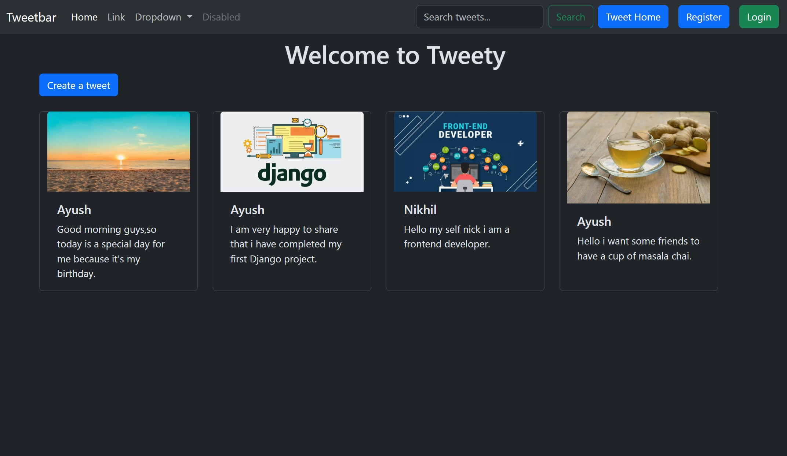

# Tweety 🐦

🌟 Welcome to **Tweety**, a Django-based web application where users can create, manage, edit, and delete their tweets. Built with Django and Bootstrap, Tweety provides a simple and user-friendly platform for sharing thoughts and managing posts. 🌟

## 🕶 Preview



## 📝 Overview

Tweety is a web application developed using the Django framework. It allows users to register, log in, and manage tweets through an interactive interface. The project demonstrates the implementation of Django's Model-View-Template (MVT) architecture, database integration, user authentication, and CRUD (Create, Read, Update, Delete) operations.

## 💎 Key Features

- **User Registration**: Create an account to access the application.
- **User Login and Logout**: Securely log in and log out using Django's built-in authentication system.
- **Create Tweets**: Write and publish tweets to share your thoughts.
- **View Tweets**: Browse the available tweets on the application.
- **Edit Tweets**: Update previously created tweets.
- **Delete Tweets**: Remove tweets with a confirmation step.
- **Database Integration**: Store and manage tweet data using SQLite.
- **Responsive UI**: Use Bootstrap styling to create a clean and user-friendly interface.

## 🛠️ Technologies Used

- **Python**: Implement the application's backend logic.
- **Django**: Handle routing, views, templates, database operations, and authentication.
- **HTML5**: Structure the web pages.
- **CSS3**: Style the application's interface.
- **Bootstrap**: Enhance the design with reusable UI components.
- **SQLite**: Store application data, including tweets and user information.

## 🚀 Getting Started

To run Tweety locally, follow these steps:

### 1. Clone the Repository

```bash
git clone <your-github-repository-url>
```

### 2. Navigate to the Project Directory

```bash
cd tweetyhq
```

### 3. Create and Activate a Virtual Environment

```bash
python -m venv .venv
```

On Windows:

```bash
.venv\Scripts\activate
```

### 4. Install Dependencies

```bash
pip install -r requirements.txt
```

### 5. Apply Database Migrations

```bash
python manage.py migrate
```

### 6. Run the Development Server

```bash
python manage.py runserver
```

### 7. Open the Application

Visit the following URL in your browser:

```text
http://127.0.0.1:8000/
```

## 🤝 Contributing

Contributions to improve Tweety, add new features, or fix bugs are welcome! Follow these steps to contribute:

1. Fork the repository.
2. Create a new branch for your feature or bug fix:

   ```bash
   git checkout -b feature-name
   ```

3. Make your changes and commit them:

   ```bash
   git add .
   git commit -m "Add feature or fix"
   ```

4. Push your branch to your fork:

   ```bash
   git push origin feature-name
   ```

5. Create a pull request on the original repository.

## 📄 License

Check out the license ✒ [License](LICENSE.txt)

